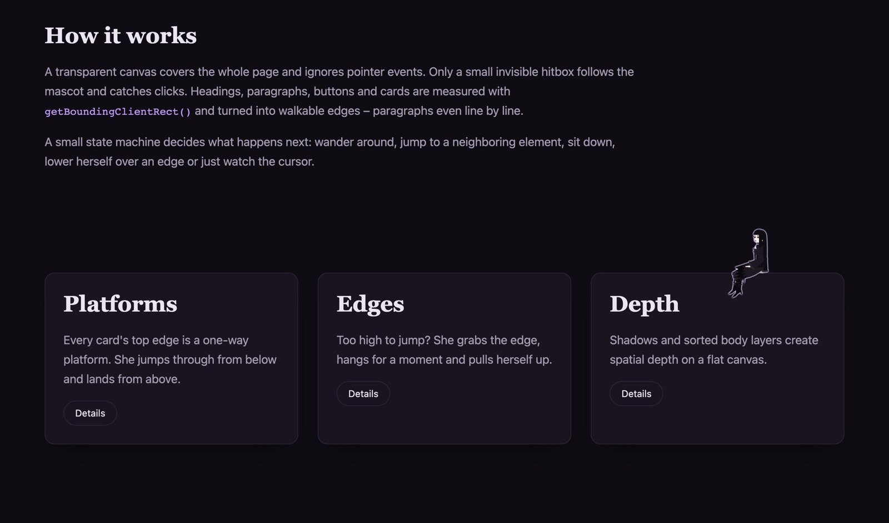

# pagegeist

[](https://www.npmjs.com/package/@d4ndel1on/pagegeist)
[](https://bundlephobia.com/package/@d4ndel1on/pagegeist)
[](#license)
[](https://github.com/d4ndel1on/pagegeist/actions/workflows/ci.yml)

***She lives here now. You're just visiting.***

**An animated mascot overlay for any web page – a tiny, bratty gothic poltergeist who haunts
it.** She walks on your headings, sits on your buttons, hangs from edges, shimmies along lines
of text and climbs up – your real DOM is her level, and she acts like she owns it. Click her,
drag her around, throw her (she will complain). Your page stays fully usable.

Use her as an easter egg or to give a portfolio, landing page, docs site or side project some
personality. Vanilla JS core with zero dependencies, plus a React adapter (Next.js ready).

```sh
npm install @d4ndel1on/pagegeist
```

<!-- snippet: examples/minimal.ts -->
```ts
import { createPagegeist } from '@d4ndel1on/pagegeist';

createPagegeist({ pauseControl: true }); // React: <Pagegeist pauseControl /> from '@d4ndel1on/pagegeist/react'
```

**[Live demo](https://d4ndel1on.github.io/pagegeist/)** · [Quick start](#quick-start) ·
Using an AI coding agent? Point it at [docs/usage-for-agents.md](docs/usage-for-agents.md)
(also shipped in the npm package) or [llms.txt](https://d4ndel1on.github.io/pagegeist/llms.txt).



## Why let her haunt your page

- **Your page is the level** – headings, text lines, buttons and cards become platforms; fixed/sticky headers are avoided automatically.
- **Zero runtime dependencies, no image assets** – fully procedural Canvas 2D drawing, ~24 kB min+brotli. The size budget is enforced in CI.
- **React adapter included** – `<Pagegeist />`, `usePagegeist()`, imperative ref; StrictMode-safe, SSR-safe and marked `"use client"` (Next.js App Router ready). The vanilla core works anywhere.
- **Reduced motion done properly** – `prefers-reduced-motion` is watched at runtime with four modes (`static`, `calm`, `hidden`, `ignore`).
- **CSP-safe** – no `eval`, no inline scripts, no injected `<style>`; phrases are always rendered as plain text.
- **Light on the page** – no rescans while scrolling, the loop sleeps while paused and stops in background tabs.
- **Supply chain** – published from CI with npm provenance; SHA-pinned GitHub Actions.
- **Yours to style** – outfit, shoes, fishnets, phrases & i18n, behaviors, events.

*"Reduced motion? I'll sit still. Happy now?"*

## Install

*"Ugh. Fine. Install me."*

```sh
npm install @d4ndel1on/pagegeist
```

React 18.2+ or 19 is an optional peer dependency – only needed for the `/react` entry.

Without a bundler, pin an exact version from a CDN:

```html
<script type="module">
  import { createPagegeist } from 'https://esm.sh/@d4ndel1on/pagegeist@0.1.2';
  createPagegeist();
</script>
```

## Quick start

### React

<!-- snippet: examples/react.tsx -->
```tsx
import { Pagegeist } from '@d4ndel1on/pagegeist/react';

export function Layout({ children }: { children: React.ReactNode }) {
  return (
    <>
      {children}
      <Pagegeist pauseControl />
    </>
  );
}
```

### Next.js (App Router)

The React entry is marked `"use client"`, so you can render it directly from a server
component layout – no `dynamic(..., { ssr: false })` needed. It renders nothing on the server.

<!-- snippet: examples/next-app-layout.tsx -->
```tsx
// app/layout.tsx
import { Pagegeist } from '@d4ndel1on/pagegeist/react';

export default function RootLayout({ children }: { children: React.ReactNode }) {
  return (
    <html lang="en">
      <body>
        {children}
        <Pagegeist pauseControl />
      </body>
    </html>
  );
}
```

> Callback props (`onLand`, `phrases` as a function, …) cannot be passed from a server
> component. Wrap `<Pagegeist />` in your own client component when you need them – see
> [Usage for agents](docs/usage-for-agents.md#nextjs-app-router).

### Vanilla JS

<!-- snippet: examples/vanilla.ts -->
```ts
import { createPagegeist } from '@d4ndel1on/pagegeist';

const pagegeist = createPagegeist({ pauseControl: true });
pagegeist.say('Oh. You again.');
// later: pagegeist.destroy();
```

## Make her yours

```tsx
const ref = useRef<PagegeistHandle>(null);

<Pagegeist
  ref={ref}
  size={140}
  outfit="corset"
  shoes="heels"
  fishnets
  phrases={{
    poke: ['Hey.', 'Rude.'],
    landOn: { '.buy-button': ['Click it. I dare you.'] },
  }}
  behaviors={{ hang: false, drag: false }}
  platforms={{ ignore: ['footer', '.modal'] }}
  pauseControl
  onLand={({ element }) => console.log('landed on', element)}
/>;

ref.current?.say('Took you long enough.');
```

Or right in your markup – `data-pagegeist-say` is what she says when she lands or sits on
that element, `data-pagegeist-ignore` keeps her off it and everything inside:

```html
<button data-pagegeist-say="This button is mine now.|Press it.">Subscribe</button>
<aside data-pagegeist-ignore>She never walks on anything in here.</aside>
```

*"Off-limits? We'll see."* (She respects it anyway.)

## Accessibility

She is decorative: `aria-hidden`, never focusable, and your DOM stays untouched unless you
opt in. Reduced motion is honored by default. The **pause control is off by default** –
if your site needs to conform to WCAG 2.2.2 (Pause, Stop, Hide), enable `pauseControl` or
provide your own pause button. See [Accessibility](docs/accessibility.md).

## Browser support

Evergreen browsers: **Chrome/Edge 86+, Firefox 79+, Safari 14+ (iOS 14+)**. The package is
compiled to ES2022 and needs `ResizeObserver`, `MutationObserver` and Pointer Events
(`createPagegeist()` throws a clear `pagegeist: …` error without the observers). Newer APIs such
as `checkVisibility()` and `CanvasRenderingContext2D.roundRect()` are used when available,
with fallbacks. Touch is supported: tap to poke, drag to carry and throw.

## Documentation

| | |
|---|---|
| [Usage for agents](docs/usage-for-agents.md) | Copy-paste setups (vanilla, React, Next.js, Vite) and the rules that keep an integration correct |
| [Usage guide](docs/guide.md) | How she works, platforms, phrases, events, React semantics, touch, stacking |
| [API reference](docs/api.md) | Every option, event, method and export |
| [Recipes](docs/recipes.md) | i18n, easter eggs, CTA reactions, quiet mode, CDN, tests … |
| [The character](docs/character.md) | Design, wardrobe, size, outline, licensing of the artwork |
| [Accessibility](docs/accessibility.md) | Reduced motion, pause control, screen readers |
| [FAQ & troubleshooting](docs/faq.md) | Performance, z-index, sticky headers, CSP, browser support … |
| [Changelog](CHANGELOG.md) · [Contributing](CONTRIBUTING.md) · [Security](SECURITY.md) | Releases, development setup, reporting vulnerabilities |

Run the playground locally with `npm run dev` in this repository.

## Versioning

pagegeist follows [Semantic Versioning](https://semver.org/). While the version is **0.x**,
breaking changes can land in minor releases (`0.1` → `0.2`) and are called out in the
[changelog](CHANGELOG.md); patch releases stay compatible. Pin a minor range (`~0.1.0`) if
you want to opt in to changes explicitly. **1.0** will mark a stable API: from then on,
breaking changes only in major versions.

## License

- Code: [MIT](LICENSE)
- Character design: [CC0 1.0](LICENSE-ARTWORK) – public domain, use her however you like.
